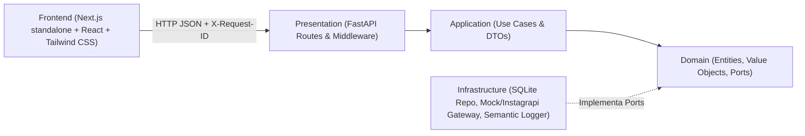

# Arquitetura — DDD, Clean Architecture e SOLID

## Visao Geral das Camadas

## Responsabilidades (`backend/src/`)

1. **Domain (`domain/` — 100% puro):**
   - `InstagramProfile` (`entities/instagram_profile.py`): entidade central com `pk`, `username`, `full_name`, `is_following`, `is_follower`, `is_verified` e `mark_unfollowed()`.
   - `NameBucket` (`value_objects/name_bucket.py`): normaliza acentos via Unicode NFKD e classifica `full_name` em `A–Z`, `0-9` ou `SPECIAL`.
   - `ProfileRepository` e `InstagramGateway`: interfaces abstratas (Ports).
2. **Application (`application/`):**
   - `SyncRelationshipsUseCase`: sincroniza Seguindo e Seguidores via gateway e persiste snapshot consolidado.
   - `ListProfilesByBucketUseCase`: filtra por lista (`following`, `followers`, `non_followers`), bucket (`A–Z`, `0-9`, `SPECIAL`) e busca, ordenando alfabeticamente pelo nome de exibicao.
   - `UnfollowProfileUseCase`: valida estado, envia comando de unfollow ao gateway e so entao atualiza o cache local.
3. **Infrastructure (`infrastructure/`):**
   - `SQLiteProfileRepository` + `SQLiteDatabase`: queries estaticas parametrizadas (zero interpolacao SQL) para filtragem instantanea.
   - `MockInstagramGateway` e `InstagrapiGateway`: adaptadores intercambiaveis via `INSTAGRAM_GATEWAY`.
   - `SemanticJsonFormatter` / `SemanticConsoleFormatter` + `contextvars`: observabilidade em `stdout` com redacao de segredos.
4. **Presentation (`presentation/`):**
   - `GET /api/health`
   - `POST /api/relationships/sync`
   - `GET /api/relationships?list_type=...&bucket=...&q=...`
   - `POST /api/relationships/{pk}/unfollow`
